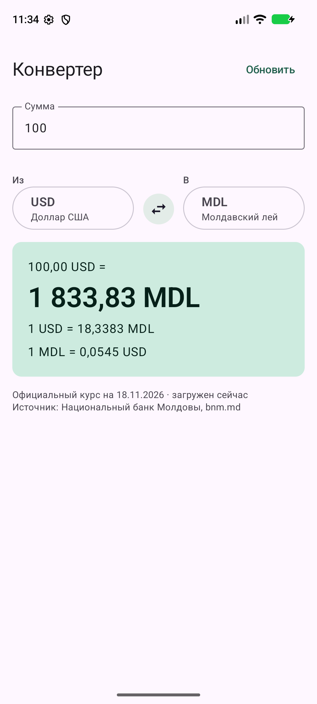
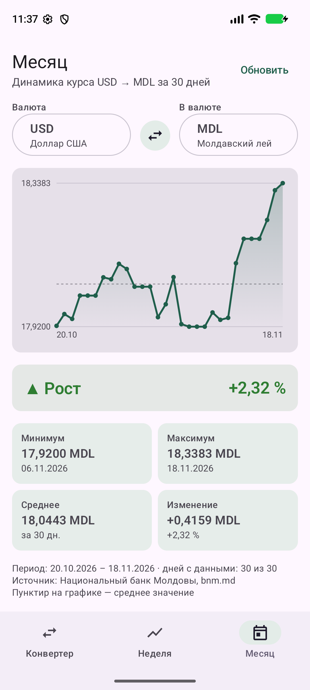
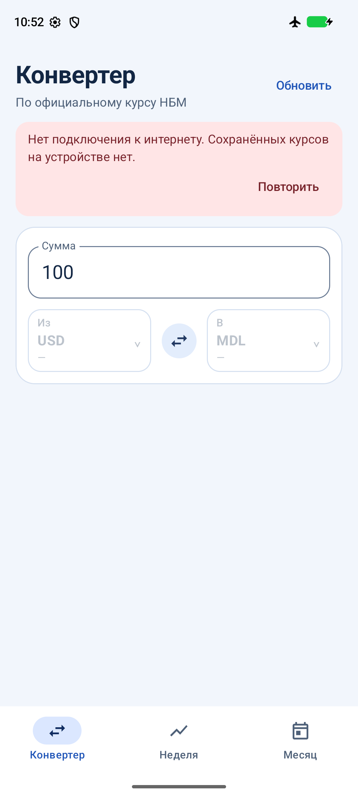

# Курс НБМ — мобильный конвертер валют (Android)

Лабораторная работа №4 по ПСИ. Конвертер валют по официальному курсу Национального банка
Молдовы (вариант Б: перенос конвертера из лаб 3 на мобильную платформу) с обязательным
расширением — экранами сравнения курса за неделю и за месяц.

**Язык:** Kotlin (лаб 3 написана на Python). **UI:** Jetpack Compose, Material 3.
**Платформа:** Android 8.0+ (minSdk 26).

| Конвертер | Неделя | Месяц |
|---|---|---|
|  |  |  |

| Без сети, данные сохранены | Неделя без сети | Без сети и без сохранённых данных |
|---|---|---|
|  |  |  |

## Возможности

- **Конвертер:** сумма, выбор валют (41 валюта с русскими названиями), обмен местами,
  результат с прямым и обратным курсом, дата курса и источник. Пересчёт на лету, проверка
  ввода с понятными сообщениями.
- **Неделя / Месяц:** динамика курса выбранной пары за 7 и 30 дней — график, минимум и
  максимум (с датами), среднее, изменение в единицах и в процентах, тенденция
  (▲ рост / ▼ падение / ▶ без изменений).
- **Без сети:** приложение не падает. Показываются сохранённые на устройстве данные с
  предупреждением, причиной и датой актуальности; кнопка «Повторить».

## Источник данных

Официальная XML-выгрузка НБМ: `https://www.bnm.md/ru/official_exchange_rates?get_xml=1&date=ДД.ММ.ГГГГ`.

Исторические данные: запрос к НБМ по каждой дате периода (параллельно, до 4 запросов) и
накопление на устройстве — каждый загруженный день сохраняется как XML в
`files/rates/rates_ГГГГ-ММ-ДД.xml`. Официальный курс прошедшей даты не меняется, поэтому
сохранённый день повторно не запрашивается. Месячный график доступен сразу после установки,
если есть сеть, — ждать накопления данных не нужно. Ограничения описаны в [REPORT.md](REPORT.md).

## Сборка и запуск

Нужны Android SDK (platform 37) и JDK 17+. Проще всего — Android Studio: **File → Open** эту
папку, затем **Run** на эмуляторе или телефоне.

Из командной строки (Windows, PowerShell). Gradle 9 требует Java 17+; если в `PATH` стоит
Java 8, укажите JDK, встроенный в Android Studio:

```powershell
$env:JAVA_HOME = "C:\Program Files\Android\Android Studio\jbr"
.\gradlew assembleDebug
adb install -r app\build\outputs\apk\debug\app-debug.apk
```

Путь к SDK берётся из `local.properties` (`sdk.dir=…`), Android Studio создаёт его сам.

## Тесты

Одна команда (с тем же `JAVA_HOME`):

```powershell
.\gradlew test
```

45 JUnit-тестов, сеть не нужна:

| Набор | Что проверяет |
|---|---|
| `BnmXmlParserTest` | разбор настоящего ответа НБМ, номинал (JPY за 100), битые элементы, некорректный XML |
| `StatisticsTest` | минимум, максимум, среднее, изменение и процент, тенденция, пустой набор, один день |
| `AmountInputTest` | проверка ввода: допустимые форматы, пустое поле, буквы, ноль, минус, лишние знаки |
| `CurrencyConverterTest` | USD↔MDL, кросс-курс с номиналом, та же валюта, обратная конвертация всех пар |
| `FormatTest` | разряды, запятая, проценты, даты |
| `RatesRepositoryTest` | откат на ранние даты, работа без сети, сохранённые дни, история, битый кэш |

## Как проверить работу без сети

1. Запустить приложение с сетью, открыть вкладки «Неделя» и «Месяц» — дни сохранятся.
2. Включить режим полёта, закрыть и снова открыть приложение.
3. Конвертер и экраны сравнения работают на сохранённых данных; жёлтая плашка сообщает
   «Нет подключения к интернету» и дату, на которую данные актуальны.
4. Сбросить данные приложения (Настройки → Приложения → Курс НБМ → Очистить хранилище) в
   режиме полёта — приложение не падает и сообщает, что сохранённых курсов нет.

## Устройство

| Пакет / файл | Назначение |
|---|---|
| `data/BnmApi.kt` | HTTP-клиент НБМ: 404 — курс не опубликован, тайм-аут 10 с, понятные сообщения об ошибках |
| `data/BnmXmlParser.kt` | Разбор XML в `RateSnapshot` |
| `data/RateCacheStore.kt` | Кэш по датам на устройстве, атомарная запись |
| `data/RatesRepository.kt` | Курс на дату с откатом до 10 дней, история за период, работа без сети |
| `domain/CurrencyConverter.kt` | Конвертация через лей на `BigDecimal` |
| `domain/Statistics.kt` | Статистика периода и тенденция |
| `domain/AmountInput.kt`, `domain/Format.kt` | Проверка ввода, форматирование по-русски |
| `ui/` | ViewModel, экраны Compose, график на Canvas |

## Git

Каждый этап — отдельная ветка, слияние в `main` только через Pull Request:
`setup/project-skeleton` → `feature/data-layer` → `feature/converter-screen` →
`feature/analytics-screens` → `test/unit-tests` → `fix/review-findings` → `docs/report`.
