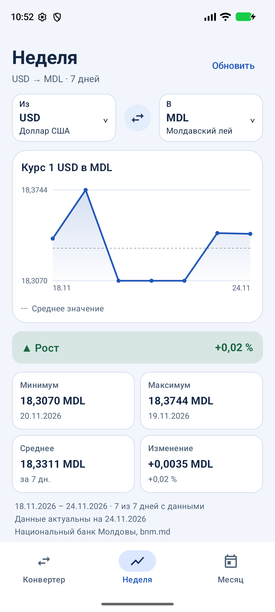
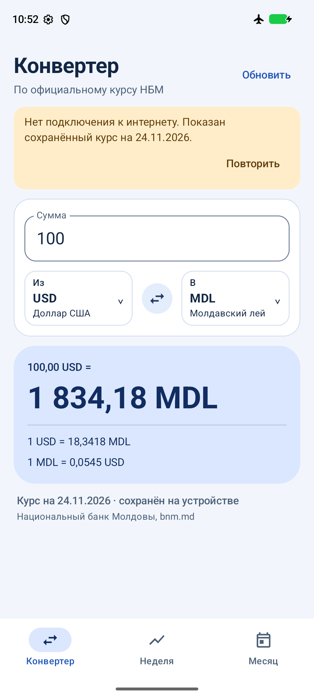
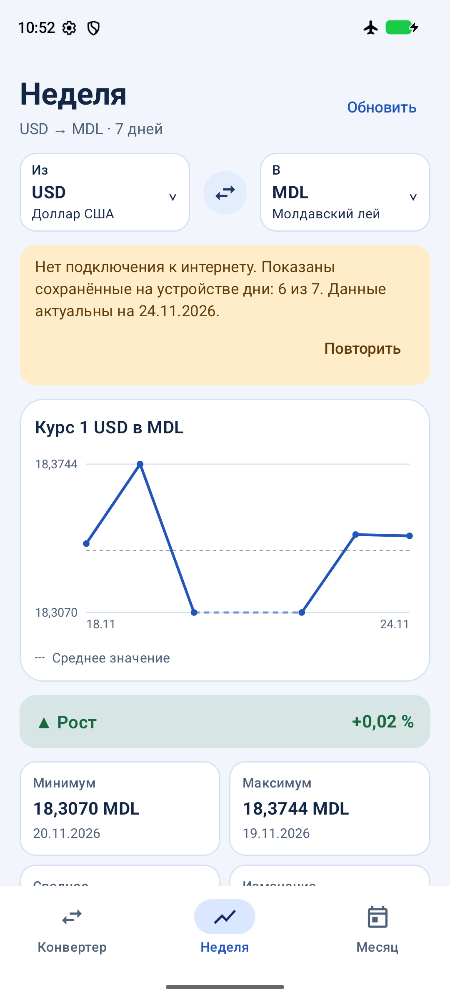
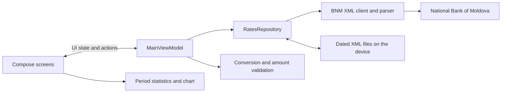
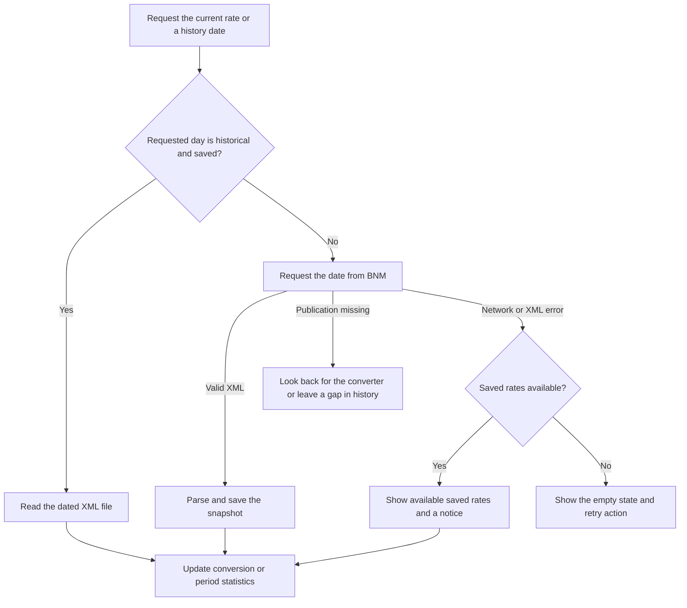

# NBM Exchange Rates for Android

Software Engineering Lab 4, option B. This native Android app brings the Lab 3 currency converter to mobile and adds seven-day and thirty-day exchange-rate comparisons. It uses Kotlin, Jetpack Compose, and Material 3 on Android 8.0 and later.

| Converter | Week | Month |
| --- | --- | --- |
|  |  |  |

| Offline converter with cache | Offline weekly view | Offline with an empty cache |
| --- | --- | --- |
|  |  |  |

## Features

- Convert as you type, pick or swap currencies, and see the direct and inverse rates. The converter identifies the official rate date and its source.
- Compare the same currency pair over 7 or 30 calendar days. The chart displays the observed dates and the average. Statistics show the minimum and maximum with their dates, the average, the absolute and percentage change, and the trend.
- Use previously downloaded data when the source is unavailable. The app explains what happened, shows the latest available date, and offers a retry.
- The Russian interface follows the Android system light or dark theme.

## Build and run

Open this repository in Android Studio with Android SDK Platform 37 and JDK 17 or later. Select an emulator or a device and choose **Run**. Android Studio records the SDK path in `local.properties`.

Run the following from the repository root in Windows PowerShell. If `adb` is unavailable on `PATH`, use the executable in the SDK's `platform-tools` directory.

```powershell
$env:JAVA_HOME = 'C:\Program Files\Android\Android Studio\jbr'
.\gradlew.bat assembleDebug
adb install -r app\build\outputs\apk\debug\app-debug.apk
```

## Architecture



The app uses the National Bank of Moldova's official rate feed at `https://www.bnm.md/ru/official_exchange_rates?get_xml=1&date=DD.MM.YYYY`. It prefers a network request for the current day and uses cached past dates when available. It can retrieve up to four historical dates at a time, so weekly and monthly views are available after the first online load. Successful responses are stored as `files/rates/rates_YYYY-MM-DD.xml`.

### History and cache



## Tests

```powershell
.\gradlew.bat test
```

The 45 local JUnit tests run without network access. They cover XML parsing and currency denominations, decimal conversion and round trips, amount validation, formatting, statistics, date fallback, saved history, and damaged cache files.

To check offline behavior on an emulator, first open the converter, week, and month with connectivity. Enable airplane mode and relaunch the app. The saved rates and charts should remain available with the date and retry action. For the empty-cache case, repeat the check with a fresh installation on a test emulator.

## Lab report

The report covers the move from Python to Kotlin, the historical data source, the development tools and AI model, and the corrections made after review. [Lab 4 report](REPORT.md)

The original development stages were merged through pull requests, from project setup and the data layer through conversion, analytics, testing, review fixes, and documentation.
